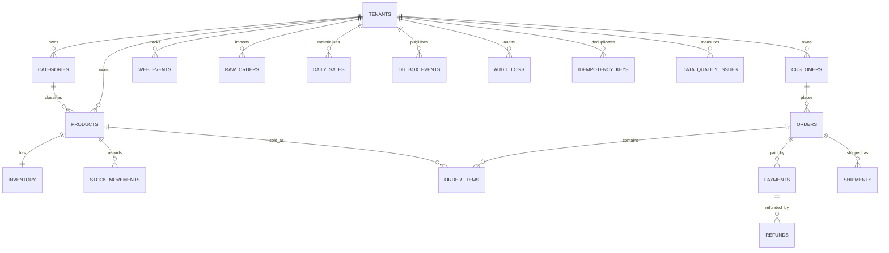

# 04 — Diccionario de datos y reglas analíticas

## Entidades

| Tabla | PK / relaciones | Campos significativos | Uso |
|---|---|---|---|
| `core.tenants` | `id` | `slug`, `display_name` | Empresas aisladas |
| `core.customers` | `id`, (`tenant_id`,`id`) único | `email`, `country_code`, `acquisition_channel`, `acquired_at` | Cohortes, adquisición |
| `core.categories` | `id`, unique tenant/name | `name` | Dimensión de productos |
| `core.products` | `id`, FK categoría tenant-safe | `sku`, `unit_price`, `unit_cost`, `is_active` | Catálogo actual |
| `core.inventory` | (`tenant_id`,`product_id`) | `available_qty`, `reserved_qty`, `version` | Saldo operacional |
| `core.stock_movements` | ID identity | `qty_delta`, `reason`, `recorded_at` | Futuro ledger/conciliación |
| `core.orders` | `id`, FK cliente tenant-safe | `order_number`, `order_status`, `ordered_at` | Cabecera comercial |
| `core.order_items` | `id`, FK pedido y producto | `quantity`, `unit_price`, `discount_amount` | Snapshot de precio por línea |
| `core.payments` | `id`, FK pedido | `amount`, `payment_status`, `processed_at` | Movimientos de cobro |
| `core.refunds` | `id`, FK pago | `amount`, `refund_status`, `refunded_at` | Devoluciones |
| `core.shipments` | `id`, FK pedido | `shipment_status`, `shipping_cost`, `delivered_at` | Operación logística |
| `events.web_events` | `id`, cliente/producto opcional | `session_id`, `event_type`, `occurred_at`, `properties` | Eventos de navegación |
| `ops.idempotency_keys` | tenant/endpoint/key | `request_hash`, `response_status`, `response_body`, `expires_at` | Dedupe eventual |
| `ops.outbox_events` | ID identity | `event_type`, `payload`, `published_at`, `attempts` | Publicación eventual |
| `ops.audit_logs` | ID identity | `actor_id`, `action`, `metadata` | Trazabilidad |
| `analytics.raw_orders` | `ingest_id` | `payload`, `load_status`, `error_reason` | Staging con errores |
| `analytics.daily_sales` | tenant/fecha | `gross_revenue`, `discount_total`, `captured_payment_total`, `refunded_total` | Destino de lab ETL (vacío) |
| `analytics.data_quality_issues` | ID identity | `run_id`, `rule_id`, `issue_count`, `severity` | Destino de lab DQ (vacío) |

## Definiciones que el analista debe acordar antes de consultar

- **GMV bruto:** los ítems se valoran según snapshots históricos. Aclarar inclusión/exclusión de cancelados y status.
- **Net sales vs cash collected:** ingresos por órdenes e ingresos capturados no son idénticos. Definir fecha de atribución (`ordered_at` vs `processed_at` vs `refunded_at`).
- **AOV:** el denominador debe usar la misma población de pedidos que el numerador.
- **Revenue:** no mezclar pagos múltiples con líneas y multiplicar importes por joins en abanico.
- **Refund rate:** elegir denominador, fecha y si se consideran refund `completed` o `requested`.
- **Cohortes:** usar `acquired_at` para adquisición, o primera compra para compra, sin confundirlas.
- **Retención:** especificar calendario mensual UTC, clientes elegibles y actividad válida.
- **Funnel:** definir orden temporal por sesión, repetición de eventos y condiciones de conversión; eventos no equivalen a órdenes pagadas.
- **RFM:** ventana de observación, unidad monetaria, pedidos válidos y reglas de desempate.
- **Margen:** `products.unit_cost` representa costo **actual**, no costo histórico auditado; declarar limitación.

## Consultas seguras

Usa `tenant_id` explícito en todas las tablas de negocio, parámetros bind y `EXPLAIN (ANALYZE, BUFFERS)` solo cuando comprendas la carga y el efecto de ejecutar la consulta. No uses `float` para dinero. Evita correlacionar datos de tenants distintos aunque ambos tengan IDs UUID válidos.

## Relaciones principales en texto

`tenant -> customers -> orders -> order_items -> products -> categories`.
`orders -> payments -> refunds`.
`orders -> shipments`.
`tenant + product -> inventory`.
`tenant -> web_events (customer/product opcionales)`.
`tenant -> raw_orders`.

## Cardinalidades

**Esquema**, no semilla: 1 tenant a N clientes; 1 cliente a N órdenes; 1 orden a N ítems; 1 orden a N pagos; 1 pago a N refunds; 1 orden a N shipments. La BD no impone que una orden tenga al menos un ítem ni que el total de pagos coincida con la suma de líneas. Estas son reglas de integridad transaccional para los ejercicios backend.

## Diagrama ER simplificado (estructura, no solución)

El diagrama muestra relaciones conceptuales. Algunas cardinalidades exactas a nivel SQL son menos estrictas que el dominio (p. ej., una orden aún puede existir sin líneas), y todas las FKs críticas de negocio deben incluir `tenant_id`.
